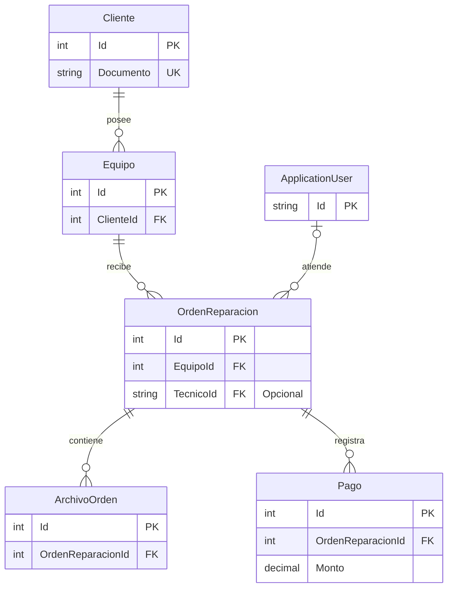

# Diagrama de entidad-relación

Una orden pertenece a un equipo. Puede ingresar sin técnico y asignarse más adelante. Los pagos y los archivos se registran sobre la orden correspondiente.

`ApplicationUser` representa al usuario de Identity. En la relación con la orden, el usuario asignado desempeña el rol de técnico. El diagrama muestra las claves y los campos necesarios para interpretar las relaciones. [Configuración del modelo](../LGS.Tech/Data/AplicationDbContext.cs)

